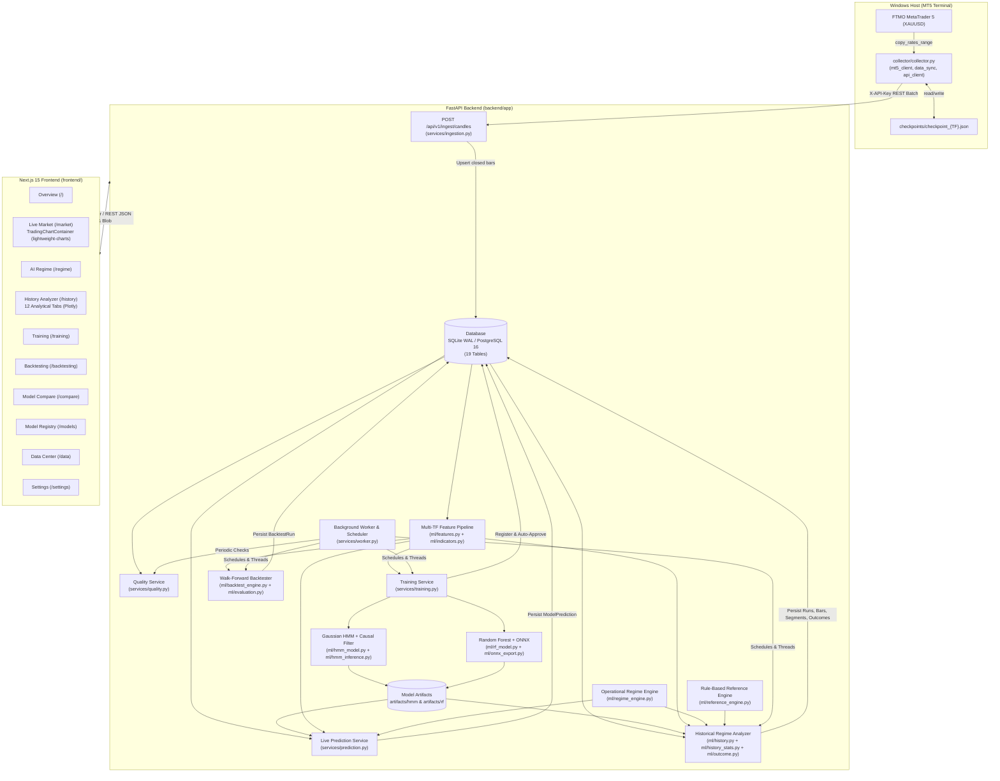

# GMRAI — Project Architecture & System Review

> **Audit Deliverable 1 of 5**  
> **Project:** Gold Market Regime AI Intelligence (`GMRAI`)  
> **Scope:** Phase 1 (Project Discovery) & Phase 4 (Architecture Review)  
> **Repository Root:** `/Users/macos/Desktop/GMRAI`

---

## 1. Executive Summary

**GMRAI (Gold Market Regime AI Intelligence)** is a multi-tier quantitative research and decision-support platform designed to classify, analyze, and monitor market regimes on **XAUUSD (Gold vs. USD)** across **M5**, **M15** (primary decision timeframe), and **H1** (macro context timeframe).

The system strictly separates:
1. **Data Collection (`collector/`)**: A Windows-resident Python daemon that connects to **FTMO MetaTrader 5**, fetches **closed candles only** (`M5`, `M15`, `H1`), maintains local per-timeframe checkpoints, and pushes batches to the backend ingestion API.
2. **AI Regime Intelligence (`backend/`)**: A **FastAPI + SQLAlchemy + Scikit-Learn/HMMLearn** service combining an unsupervised **5-state Gaussian Hidden Markov Model (HMM)** (using causal forward filtering) and a supervised **3-class Random Forest (RF)** classifier wrapped in a stateful **Operational Regime Engine** (with entry/exit hysteresis, N-bar confirmation, early trend heuristics, and data-staleness degradation).
3. **Rule-Based Reference Regime (`reference_engine.py`)**: A deterministic, causal technical rule classifier (`ref_v1`) computed alongside AI regimes to benchmark agreement, boundary shifts, and detection latency without conflating AI predictions with rule-based labels.
4. **Historical Market Regime Analyzer & Web Dashboard (`frontend/`)**: A **Next.js 15 (App Router) + React 19 + TypeScript** web application featuring a TradingView `lightweight-charts` v5 live market workstation, a 12-tab Plotly-powered Historical Regime Analyzer, a Training Center, a Walk-Forward Backtesting suite, and a Model Registry.

> [!IMPORTANT]
> GMRAI is architected as a **research and regime-classification system**, not an automated trade execution bot. Its `permission` outputs (`BUY_ONLY`, `SELL_ONLY`, `NO_TRADE`) represent analytical regime alignment rather than order-routing instructions.

---

## 2. Technology Stack Inventory

### 2.1 Collector Tier ([collector/](file:///Users/macos/Desktop/GMRAI/collector))
| Component | Technology / Version | Purpose |
|---|---|---|
| Runtime | Python 3.11+ (Windows OS required by MT5 IPC) | Runs alongside FTMO MetaTrader 5 terminal |
| Broker Bridge | `MetaTrader5>=5.0.5488` | Native Python IPC binding to `terminal64.exe` |
| HTTP Client | `requests>=2.32.3` | Exponential-backoff POST client to `/api/v1/ingest/candles` |
| Data Handling | `numpy>=1.26.4`, `pandas>=2.2.3`, `python-dotenv>=1.0.1` | UTC timestamp conversion, closed-bar filtering, `.env` config |
| State Persistence | Local JSON (`collector/checkpoints/checkpoint_{TF}.json`) | Per-timeframe last-synced bar timestamp |

### 2.2 Backend Tier ([backend/](file:///Users/macos/Desktop/GMRAI/backend))
| Component | Technology / Version | Purpose |
|---|---|---|
| Web Framework | `fastapi==0.115.6`, `uvicorn[standard]==0.32.1` | REST API (`/api/v1/*`), OpenAPI docs, lifespan hooks |
| ORM & Migrations | `sqlalchemy==2.0.36`, `alembic==1.14.0` | 19 relational tables, 4 schema migrations (`0001`–`0004`) |
| Database | SQLite WAL (`gmrai.db` in dev) / PostgreSQL 16 (`psycopg2-binary==2.9.10` in prod) | Time-series candle store, model registry, history analyzer store |
| Auth & Security | `PyJWT==2.10.1`, `bcrypt==4.0.1`, `slowapi==0.1.9` | JWT Bearer auth, RBAC (`admin`/`viewer`), `X-API-Key` ingestion auth |
| Unsupervised ML | `hmmlearn==0.3.2` + custom NumPy [`HmmFilter`](file:///Users/macos/Desktop/GMRAI/backend/app/ml/hmm_inference.py#L14-L98) | 5-state diagonal-covariance Gaussian HMM + causal forward filter |
| Supervised ML | `scikit-learn==1.5.2`, `joblib==1.4.2` | Balanced Random Forest classifier, isotonic calibration |
| Model Export | `skl2onnx==1.17.0`, `onnx==1.17.0`, `onnxruntime==1.18.1` | ONNX export of RF classifier for MQL5 / cross-runtime parity |
| Reporting | `openpyxl==3.1.5`, `reportlab==4.2.5` | History run exports (`CSV`, `XLSX`, `PDF`) |
| Testing | `pytest==8.3.4`, `httpx==0.28.1` | 17 test modules covering ML causality, API, history, and collector logic |

### 2.3 Frontend Tier ([frontend/](file:///Users/macos/Desktop/GMRAI/frontend))
| Component | Technology / Version | Purpose |
|---|---|---|
| Framework | `next@15.3.0` (App Router), `react@19.0.0`, `typescript@5.6.3` | SPA-style authenticated dashboard (Vietnamese UI) |
| Data Fetching | `swr@2.3.0` + custom [`lib/api.ts`](file:///Users/macos/Desktop/GMRAI/frontend/lib/api.ts) | Client-side caching, polling, and Bearer token injection |
| Live Financial Chart | `lightweight-charts@^5.0.0` | Interactive candlestick chart, volume histogram, EMA20/50, AI & Reference regime bands |
| Analytical Charts | `plotly.js-dist-min@^2.35.2`, `react-plotly.js@^2.6.0` | Heatmaps, confusion matrices, horizontal bars, regime timelines |
| Styling | CSS Modules (`*.module.css`) + [`app/globals.css`](file:///Users/macos/Desktop/GMRAI/frontend/app/globals.css) | Dark quantitative terminal theme |

### 2.4 Infrastructure & Deployment ([docker-compose.yml](file:///Users/macos/Desktop/GMRAI/docker-compose.yml))
| Service | Image / Build | Role |
|---|---|---|
| `postgres` | `postgres:16-alpine` | Primary production relational store |
| `backend` | [`docker/Dockerfile.backend`](file:///Users/macos/Desktop/GMRAI/docker/Dockerfile.backend) | `alembic upgrade head` + `uvicorn app.main:app` |
| `worker` | [`docker/Dockerfile.backend`](file:///Users/macos/Desktop/GMRAI/docker/Dockerfile.backend) | `python -m app.worker_main` background scheduler |
| `frontend` | [`docker/Dockerfile.frontend`](file:///Users/macos/Desktop/GMRAI/docker/Dockerfile.frontend) | Next.js production server on port `3000` |
| `nginx` | `nginx:1.27-alpine` + [`docker/nginx.conf`](file:///Users/macos/Desktop/GMRAI/docker/nginx.conf) | Reverse proxy (`/` → frontend, `/api/` → backend) |

---

## 3. System Architecture & Module Dependency Map

### 3.1 Backend Module Dependency Map
- **Entrypoints**:
  - [`app/main.py`](file:///Users/macos/Desktop/GMRAI/backend/app/main.py): Configures CORS, `slowapi` rate limiter, lifespan startup (`seed_defaults` + `worker.start_scheduler`), and mounts 12 API routers under `/api/v1`.
  - [`app/worker_main.py`](file:///Users/macos/Desktop/GMRAI/backend/app/worker_main.py): Standalone daemon entrypoint invoking `seed_defaults()` and `worker.start_scheduler()`.
- **Core Infrastructure**:
  - [`app/config.py`](file:///Users/macos/Desktop/GMRAI/backend/app/config.py) → `Settings` (`GMRAI_*` env vars).
  - [`app/db.py`](file:///Users/macos/Desktop/GMRAI/backend/app/db.py) → SQLAlchemy engine/session factory (`WAL`, `busy_timeout=30000` on SQLite).
  - [`app/models/models.py`](file:///Users/macos/Desktop/GMRAI/backend/app/models/models.py) → 19 ORM models (`User`, `ApiKey`, `MarketCandle`, `DataSyncLog`, `DataQualityReport`, `MarketFeature`, `HmmModel`, `RandomForestModel`, `ModelVersion`, `ModelPrediction`, `TrainingRun`, `BacktestRun`, `BacktestMetric`, `BackgroundJob`, `SystemLog`, `RegimeHistoryRun`, `RegimeHistoryBar`, `RegimeSegment`, `OutcomeEvaluation`).
  - [`app/security/auth.py`](file:///Users/macos/Desktop/GMRAI/backend/app/security/auth.py) & [`app/deps.py`](file:///Users/macos/Desktop/GMRAI/backend/app/deps.py) → Bcrypt hashing, SHA-256 API key hashing, JWT creation/decoding, `get_current_user`, `require_admin`, `verify_ingest_api_key`.
- **ML Core (`app/ml/`)**:
  - [`indicators.py`](file:///Users/macos/Desktop/GMRAI/backend/app/ml/indicators.py) → Causal `ema`, `sma`, `true_range`, `atr` (Wilder), `adx` (`+DI`, `-DI`, `ADX`), `efficiency_ratio` (Kaufman), `log_return`.
  - [`features.py`](file:///Users/macos/Desktop/GMRAI/backend/app/ml/features.py) → `compute_m15_features` (7 features), `compute_h1_features` (4 features), `compute_m5_features` (3 features), `asof_closed` (causal `pd.merge_asof` on bar close time `open_ts + period`), `build_features` (14 features total, `FEATURE_VERSION = "v1"`).
  - [`labels.py`](file:///Users/macos/Desktop/GMRAI/backend/app/ml/labels.py) → `compute_labels` (`fwd_ret = close[t+h] - close[t]` vs `±0.75 * ATR14(t)`).
  - [`splits.py`](file:///Users/macos/Desktop/GMRAI/backend/app/ml/splits.py) → `chronological_indices`, `purge_train_indices`, `walk_forward_folds`, `sub_train_val_split`.
  - [`hmm_inference.py`](file:///Users/macos/Desktop/GMRAI/backend/app/ml/hmm_inference.py) → Pure NumPy [`HmmFilter`](file:///Users/macos/Desktop/GMRAI/backend/app/ml/hmm_inference.py#L14-L98) (`filter_sequence`, `step`, `predict_last_with_warmup`, `posterior_entropy`).
  - [`hmm_model.py`](file:///Users/macos/Desktop/GMRAI/backend/app/ml/hmm_model.py) → `fit_hmm_multistart`, `map_states_to_regimes`, `semantic_probabilities`, `transition_to_trend_probs`, `save_hmm_artifact`, `load_hmm_artifact`.
  - [`rf_model.py`](file:///Users/macos/Desktop/GMRAI/backend/app/ml/rf_model.py) → `build_rf_feature_matrix` (28 features: 14 market + 14 HMM state/posterior/delta/transition features), `train_rf_with_tuning`, `maybe_calibrate`, `rf_probabilities`.
  - [`regime_engine.py`](file:///Users/macos/Desktop/GMRAI/backend/app/ml/regime_engine.py) → [`RegimeEngine`](file:///Users/macos/Desktop/GMRAI/backend/app/ml/regime_engine.py#L103-L250), [`EngineParams`](file:///Users/macos/Desktop/GMRAI/backend/app/ml/regime_engine.py#L31-L59), [`EngineState`](file:///Users/macos/Desktop/GMRAI/backend/app/ml/regime_engine.py#L62-L83), `combine_probabilities`, `optimize_thresholds`.
  - [`reference_engine.py`](file:///Users/macos/Desktop/GMRAI/backend/app/ml/reference_engine.py) → Deterministic rule-based classifier (`REFERENCE_VERSION = "ref_v1"`), [`classify_reference_bars`](file:///Users/macos/Desktop/GMRAI/backend/app/ml/reference_engine.py#L94-L216), [`compare_ai_vs_reference`](file:///Users/macos/Desktop/GMRAI/backend/app/ml/reference_engine.py#L246-L370).
  - [`outcome.py`](file:///Users/macos/Desktop/GMRAI/backend/app/ml/outcome.py) → Forward outcome evaluation across horizons `12, 48, 96` M15 bars.
  - [`history.py`](file:///Users/macos/Desktop/GMRAI/backend/app/ml/history.py), [`history_stats.py`](file:///Users/macos/Desktop/GMRAI/backend/app/ml/history_stats.py), [`history_export.py`](file:///Users/macos/Desktop/GMRAI/backend/app/ml/history_export.py) → Historical regime replay, segment builder, 9 statistical aggregators, CSV/XLSX/PDF exporters.
  - [`evaluation.py`](file:///Users/macos/Desktop/GMRAI/backend/app/ml/evaluation.py) & [`backtest_engine.py`](file:///Users/macos/Desktop/GMRAI/backend/app/ml/backtest_engine.py) → Classification metrics, detection delay, false trend rate, trading simulation, expanding/rolling walk-forward engine.
  - [`onnx_export.py`](file:///Users/macos/Desktop/GMRAI/backend/app/ml/onnx_export.py) → `export_rf_to_onnx` and `verify_onnx_parity`.

---

## 4. End-to-End Data Flow Trace (XAUUSD Market Data → AI Analysis → Final Output)

### Stage 1: Market Data Acquisition & Sync (`FTMO MT5` → `Collector` → `Ingestion API`)
1. **MT5 Connection**: [`MT5Client.connect()`](file:///Users/macos/Desktop/GMRAI/collector/mt5_client.py#L39-L69) initializes the Windows MetaTrader 5 terminal, validates login/server (`FTMO-Demo`), and selects symbol `XAUUSD`.
2. **Closed-Bar Cutoff**: [`MT5Client.last_closed_bar_open()`](file:///Users/macos/Desktop/GMRAI/collector/mt5_client.py#L72-L81) computes `floor(now / tf_sec) * tf_sec - tf_sec` so **forming (unclosed) bars are never fetched**.
3. **Chunked Historical & Incremental Fetch**: [`DataSynchronizer.sync_timeframe()`](file:///Users/macos/Desktop/GMRAI/collector/data_sync.py#L99-L176) reads `checkpoints/checkpoint_{TF}.json`. On first run, it backfills 365 days in 30-day chunks (automatically halving chunk size down to 6 hours if MT5 IPC fails). On subsequent runs (every 60s), it re-fetches from `checkpoint - 50 * tf_sec` (`resync_bars=50`) to heal minor gaps.
4. **Batch Ingestion**: [`IngestionApiClient.send_candles()`](file:///Users/macos/Desktop/GMRAI/collector/api_client.py#L25-L66) POSTs batches of up to 5,000 candles to `POST /api/v1/ingest/candles` with header `X-API-Key`.
5. **Validation & Upsert**: [`ingest_candles()`](file:///Users/macos/Desktop/GMRAI/backend/app/services/ingestion.py#L46-L133) validates OHLC invariants (`high >= max(open, close)`, `low <= min(open, close)`, positive prices, future timestamp guard `ts <= now + 5m`), deduplicates within the payload, upserts into `market_candles` keyed by `(symbol, timeframe, ts)`, and writes a `DataSyncLog` entry.

### Stage 2: Multi-Timeframe Feature Engineering (`market_candles` → `build_features`)
1. **Base Grid**: M15 bar open timestamps `t` act as the primary index. Each M15 bar closes at `t + 15m`.
2. **M15 Features (7)**: [`compute_m15_features()`](file:///Users/macos/Desktop/GMRAI/backend/app/ml/features.py#L38-L53) computes `ret1`, `ret4`, `atr_ratio` (`ATR14 / SMA20(ATR14)`), `ema_slope` (`(EMA20 - EMA20[-4]) / ATR14`), `efficiency_ratio` (10-bar Kaufman ER), `adx_norm` (`ADX14 / 100`), and `di_gap` (`(+DI14 - -DI14) / 100`).
3. **Causal Multi-TF Join**: [`asof_closed()`](file:///Users/macos/Desktop/GMRAI/backend/app/ml/features.py#L78-L104) stamps each H1 bar with `_close_time = open_ts + 3600s` and each M5 bar with `_close_time = open_ts + 300s`, then performs `pd.merge_asof(..., direction="backward")` against M15 timestamp `t`.
   - *Note*: In [`asof_closed()`](file:///Users/macos/Desktop/GMRAI/backend/app/ml/features.py#L94-L100), `left_on="_t"` uses the M15 bar's **open time** `t` rather than M15 close time `t + 900s`. While strictly causal (it matches H1/M5 bars closed at or before M15 open `t`), it lags M5 by 15 minutes (matching the M5 bar that closed at `t` instead of `t + 15m`).

### Stage 3: Model Training & Registry (`services/training.py`)
1. **HMM Fitting**: [`fit_hmm_multistart()`](file:///Users/macos/Desktop/GMRAI/backend/app/ml/hmm_model.py#L45-L90) standardizes the 14 features on `subtrain`, runs multi-start EM for a 5-state diagonal Gaussian HMM, and selects the highest train log-likelihood model.
2. **Causal Filtering & State Mapping**: [`HmmFilter.filter_sequence()`](file:///Users/macos/Desktop/GMRAI/backend/app/ml/hmm_inference.py#L51-L68) computes causal forward posteriors $\alpha_t(k) = P(S_t = k \mid x_{1:t})$. [`map_states_to_regimes()`](file:///Users/macos/Desktop/GMRAI/backend/app/ml/hmm_model.py#L139-L216) maps each latent state to `TREND_UP`, `TREND_DOWN`, `SIDEWAYS`, `HIGH_VOLATILITY`, `TRANSITION`, or `UNKNOWN` using `subtrain` statistics only.
3. **RF Training**: [`build_rf_feature_matrix()`](file:///Users/macos/Desktop/GMRAI/backend/app/ml/rf_model.py#L22-L54) combines the 14 market features with 14 HMM features (5 posteriors, 5 one-hot states, max posterior, entropy, 1-bar & 3-bar posterior delta, and `trans_up`/`trans_down`). [`train_rf_with_tuning()`](file:///Users/macos/Desktop/GMRAI/backend/app/ml/rf_model.py#L67-L106) fits a balanced Random Forest against 12-bar forward ATR-normalized labels.
4. **Ensemble & Threshold Optimization**: [`optimize_thresholds()`](file:///Users/macos/Desktop/GMRAI/backend/app/ml/regime_engine.py#L253-L294) grid-searches `theta_enter`, `theta_exit`, and `confirm_bars` on `subval`, evaluates `hmm_only`, `rf_only`, and `combined` on `test`, exports RF to ONNX, and registers `ModelVersion` rows (auto-approving if `test_macro_f1 >= 0.30` and `onnx_parity.passed`).

### Stage 4: Operational Regime Detection (Live & Historical)
1. **Live Inference (`GET /api/v1/regime/latest`)**: [`compute_latest_regime()`](file:///Users/macos/Desktop/GMRAI/backend/app/services/prediction.py#L64-L249) loads recent candles, checks freshness thresholds (`M5: 15m`, `M15: 35m`, `H1: 130m`), runs `HmmFilter` with a 500-bar warmup, queries RF probabilities, steps [`RegimeEngine`](file:///Users/macos/Desktop/GMRAI/backend/app/ml/regime_engine.py#L103-L250), and persists a `ModelPrediction` row.
2. **Historical Replay (`POST /api/v1/history/run`)**: [`execute_history_run()`](file:///Users/macos/Desktop/GMRAI/backend/app/services/history.py#L75-L310) replays the full M15 history through the approved HMM+RF models and [`RegimeEngine.run_sequence()`](file:///Users/macos/Desktop/GMRAI/backend/app/ml/regime_engine.py#L244-L250), runs [`classify_reference_bars()`](file:///Users/macos/Desktop/GMRAI/backend/app/ml/reference_engine.py#L94-L216) for rule-based comparison, segments contiguous regimes via [`build_segments()`](file:///Users/macos/Desktop/GMRAI/backend/app/ml/history.py#L129-L255), and computes forward outcomes via [`compute_outcome_rows()`](file:///Users/macos/Desktop/GMRAI/backend/app/ml/outcome.py#L31-L115).

---

## 5. Phase 4 — Production Architecture Review

We evaluated the current architecture across six production dimensions:

### 5.1 Scalability & Database Architecture
- **Strengths**: Clean SQLAlchemy 2.0 ORM abstraction supporting both SQLite WAL (local development) and PostgreSQL 16 (production Docker). Batch ingestion uses dialect-specific bulk upserts (`sqlite_insert` / `pg_insert`) chunked at 500 rows per statement.
- **Bottlenecks Identified**:
  1. **Unbounded `model_predictions` Table Growth**: [`compute_latest_regime()`](file:///Users/macos/Desktop/GMRAI/backend/app/services/prediction.py#L220-L234) inserts a new row on every HTTP `GET /regime/latest` or `GET /stats/dashboard` request, even when the underlying M15 candle has not changed (verified in `gmrai.db`: 2,267 rows for just 14 distinct M15 timestamps).
  2. **Mixed Data Sources in `market_candles`**: `market_candles` stores `source` (`ftmo_mt5` vs. `synthetic_demo`), but [`MarketCandle`](file:///Users/macos/Desktop/GMRAI/backend/app/models/models.py#L46-L65) has unique key `(symbol, timeframe, ts)` without `source`, and [`training.py`](file:///Users/macos/Desktop/GMRAI/backend/app/services/training.py#L46-L69), [`prediction.py`](file:///Users/macos/Desktop/GMRAI/backend/app/services/prediction.py#L29-L55), [`market.py`](file:///Users/macos/Desktop/GMRAI/backend/app/routers/market.py#L22-L67), [`quality.py`](file:///Users/macos/Desktop/GMRAI/backend/app/services/quality.py#L27-L33), and [`worker.py`](file:///Users/macos/Desktop/GMRAI/backend/app/services/worker.py#L84-L95) do not filter by `source`. When demo data and real MT5 data coexist in the DB, queries interleave both datasets.

### 5.2 Maintainability & Code Hygiene
- **Strengths**: Well-modularized separation between `app/ml/` (pure numerical/statistical functions), `app/services/` (DB-orchestrated workflows), and `app/routers/` (thin HTTP controllers).
- **Issues Identified**:
  1. **Duplicate Stray Files**: Accidental Finder/editor copy files exist in the repository: [`backend/app/db 2.py`](file:///Users/macos/Desktop/GMRAI/backend/app/db%202.py), [`backend/app/ml/features 2.py`](file:///Users/macos/Desktop/GMRAI/backend/app/ml/features%202.py), [`backend/requirements 2.txt`](file:///Users/macos/Desktop/GMRAI/backend/requirements%202.txt), [`backend/requirements 3.txt`](file:///Users/macos/Desktop/GMRAI/backend/requirements%203.txt), and [`docs/AI_MODEL_DESIGN 2.md`](file:///Users/macos/Desktop/GMRAI/docs/AI_MODEL_DESIGN%202.md).
  2. **Dead Schema Tables**: `MarketFeature` (`market_features`) and `BacktestMetric` (`backtest_metrics`) are defined in ORM and migrations, and exposed via `GET /api/v1/features`, but never written to by any service (`0` rows in `gmrai.db`).

### 5.3 Performance & Real-Time Processing
- **Strengths**: Pure NumPy [`HmmFilter`](file:///Users/macos/Desktop/GMRAI/backend/app/ml/hmm_inference.py#L14-L98) is fast (`<5ms` for 500 bars). Next.js frontend uses `lightweight-charts` v5 canvas rendering with lazy leftward pagination (5,000 bars/page) and density downsampling in Plotly timelines.
- **Issues Identified**:
  1. **Per-Request Disk I/O & Re-Inference**: Every `GET /api/v1/regime/latest` and `GET /api/v1/stats/dashboard` reloads 3,000 candles from SQLite/Postgres, recomputes all rolling indicators (`ADX`, `ATR`, `EMA`, `ER`), reloads the HMM JSON and `joblib` RF model from disk, and re-runs inference. With 4 frontend components polling every 30s, this runs ~8 times per minute per open browser tab.
  2. **Stateful Hysteresis Corruption on Repeated Polls**: Because [`compute_latest_regime()`](file:///Users/macos/Desktop/GMRAI/backend/app/services/prediction.py#L165-L202) restores `EngineState` from the latest `ModelPrediction` row and calls `engine.step()` even when `feature_ts == prev_pred.ts`, polling `/regime/latest` multiple times within the same 15-minute bar increments `up_confirm` / `down_confirm` / `exit_count` on the same candle!

### 5.4 Reliability & Background Job Orchestration
- **Issues Identified**:
  1. **Dual Scheduler Collision in Docker Compose**: [`app/main.py`](file:///Users/macos/Desktop/GMRAI/backend/app/main.py#L31-L32) starts `worker.start_scheduler()` inside the web container when `GMRAI_AUTOMATION_ENABLED=true`, while [`docker-compose.yml`](file:///Users/macos/Desktop/GMRAI/docker-compose.yml#L49-L64) also launches a separate `worker` container running [`app/worker_main.py`](file:///Users/macos/Desktop/GMRAI/backend/app/worker_main.py). Both containers will execute duplicate scheduled quality checks and model retrains concurrently.
  2. **Orphaned `"running"` Status on Failure**: If `run_walk_forward()` fails in [`worker.py`](file:///Users/macos/Desktop/GMRAI/backend/app/services/worker.py#L103-L119) or an unhandled error occurs in [`run_training()`](file:///Users/macos/Desktop/GMRAI/backend/app/services/training.py#L103-L353) before its internal `try`, `BacktestRun.status` / `TrainingRun.status` remains stuck in `"running"` forever because `run_job()` only marks `BackgroundJob.status = "failed"`.

### 5.5 Security Posture
- **Strengths**: Passwords hashed with `bcrypt`, collector API keys hashed with `SHA-256` and compared via `hmac.compare_digest`, non-root Docker user `gmrai`, Nginx security headers (`X-Frame-Options`, `X-Content-Type-Options`).
- **Vulnerabilities & Gaps Identified**:
  1. **Missing `.gitignore` & Plaintext Credentials in [`collector/.env`](file:///Users/macos/Desktop/GMRAI/collector/.env)**: There is no `.gitignore` file in `/Users/macos/Desktop/GMRAI`, and `collector/.env` contains live FTMO Demo credentials (`MT5_LOGIN`, `MT5_PASSWORD`) and default API keys on disk.
  2. **Default Secrets in Config & Login UI**: [`backend/app/config.py`](file:///Users/macos/Desktop/GMRAI/backend/app/config.py#L22-L26) and [`frontend/app/login/page.tsx`](file:///Users/macos/Desktop/GMRAI/frontend/app/login/page.tsx#L12-L13) pre-populate `admin` / `admin-change-me` in the login form inputs.
  3. **Incomplete Rate Limiting**: [`docs/SECURITY.md`](file:///Users/macos/Desktop/GMRAI/docs/SECURITY.md) specifies rate limits on `/ingest/candles` (30/min) and general APIs (120/min), but `@limiter.limit` is only applied to `/auth/login`.

### 5.6 Architectural Verdict
The existing architecture (**Windows MT5 Collector → FastAPI/SQLAlchemy/Scikit-Learn/HMMLearn Backend → Next.js 15/Lightweight-Charts/Plotly Frontend**) is **well-suited for a production-grade GMRAI system** and **should be preserved**. No technology stack replacement is warranted. However, targeted fixes in **data source isolation, causal split embargoing, idempotent live regime prediction, background worker separation, and Telegram alerting** are required before production sign-off.
